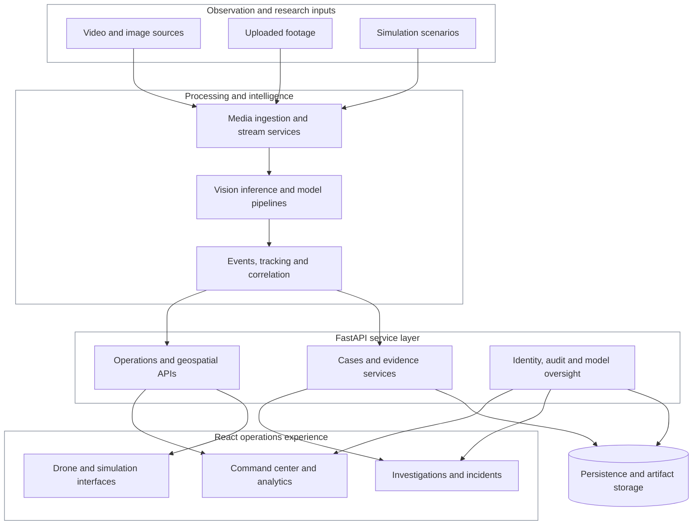
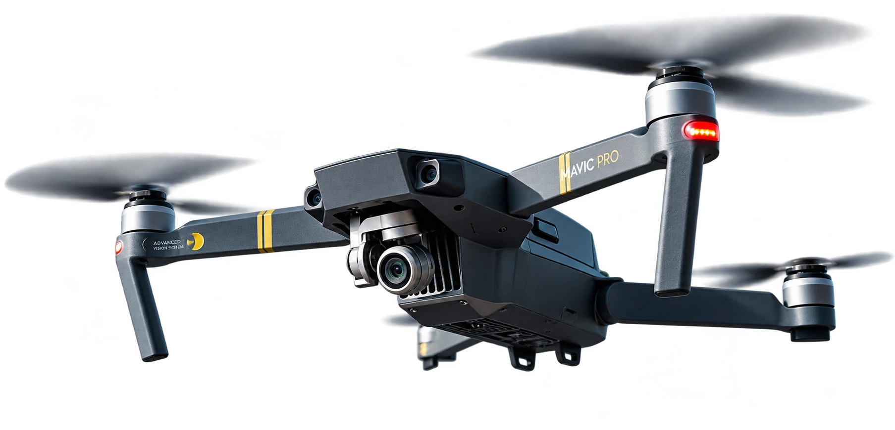

<p align="center">
  
</p>

<h1 align="center">AEGIS SENTINEL</h1>

<p align="center"><strong>From observation to understanding.</strong></p>

<p align="center">
  A research-driven intelligence and operations platform exploring how computer vision, connected signals, geospatial context and human judgment can work together.
</p>

<p align="center">
  <a href="https://aegis-sentinel-tau.vercel.app/">Explore the public experience</a> ·
  <a href="./showcase">Experience source</a> ·
  <a href="./frontend">Operations interface</a> ·
  <a href="./docs">Technical documentation</a>
</p>

---

<p align="center">
  
</p>

## A clearer view of a complex scene

Modern observation systems produce more information than any one person can comfortably assess. Cameras, recorded footage, events, locations and operational reports all tell only part of the story.

Aegis Sentinel explores a more connected approach: bringing visual analysis, event intelligence, investigative context and operator controls into a coherent workflow. Rather than presenting AI outputs as unquestionable decisions, the platform is organized around helping a person interpret evidence and choose the next action.

The project spans **two distinct experiences**:

1. **The operational research platform**, containing a React command interface, FastAPI services, inference and analysis modules, investigation tools, simulations and supporting persistence layers.
2. **The public editorial showcase**, a separate, cinematic website introducing the concept through motion, image, typography and interactive storytelling.

The showcase communicates the product vision; it is not a live feed, production surveillance deployment or model-performance demonstration.

## Designed around the operator

| Surface | Product intent |
| :--- | :--- |
| **Command overview** | Bring events, system information and actions into one navigable operational context. |
| **Video intelligence** | Support analysis of uploaded or streamed visual material through connected inference workflows. |
| **Alerts and incidents** | Organize observations into reviewable events with context for follow-up. |
| **Investigation workspace** | Connect cases, evidence, timelines and research-oriented analysis. |
| **Spatial operations** | Present location-aware information, map views and relevant operational relationships. |
| **Drone exploration** | Model mission planning, coordination and simulation-assisted aerial workflows. |
| **Model oversight** | Expose evaluation, governance and system-health interfaces alongside the operational tools. |

These are application and research surfaces represented in the repository. Their existence should not be interpreted as certification for autonomous decisions, guaranteed detection accuracy or deployment in a real-world security operation.

## How the system fits together

The code is organized so that presentation, operational APIs, analytical services and research models can evolve without becoming one tightly coupled interface.



*Conceptual module map. Data sources, models, hardware integrations and persistence backends depend on environment and scenario configuration.*

### Technology, with a purpose

| Layer | Tools and systems |
| :--- | :--- |
| Operational UI | React, Vite, JavaScript, Mapbox GL, Recharts |
| Interaction | Framer Motion and GSAP within the operational frontend |
| Services | Python, FastAPI, HTTP and WebSocket interfaces |
| AI research | YOLO-based detection, tracking and supporting inference modules |
| Data and audit | PostgreSQL-oriented persistence, event and case records, artifact storage |
| Simulation | Scenario services, drone workflows and test fixtures |
| Public storytelling | Vite, GSAP, Lenis, locally bundled imagery and typography |
| Validation | Pytest, Vitest, Playwright and model-evaluation tooling |

## A second experience: the story of Aegis

The public-facing website is intentionally separate from the operations platform. It approaches Aegis through atmosphere, editorial composition and a recurring aerial protagonist, while leaving technical detail accessible in this repository.

<p align="center">
  
</p>

The experience includes scroll-directed sequences, observation chapters, responsive imagery and a book-inspired narrative treatment. Motion is choreographed to support the story, with reduced-motion accommodations documented in the showcase implementation.

- [Experience implementation](showcase/)
- [Interaction and motion research](showcase/docs/CHOREOGRAPHY_RESEARCH.md)
- [Image provenance and asset boundaries](showcase/docs/assets.json)

Editorial imagery and simulated scenarios are presented as design and research material, not as actual Aegis field captures or validated detection results.

## Inside the repository

```text
showcase/               Independent public-facing experience
frontend/
  src/pages/            Command center, incidents, maps and tools
  src/components/       Operational interface systems
  e2e/                  Browser testing
backend/
  app/api/              Service endpoints and access boundaries
  app/services/         Video, cases, identity, drone and event logic
core/                   Runtime foundations and event infrastructure
inference/              Runtime inference pathways
ml/                     Research models and training interfaces
configs/                Environment and model configuration
simulation/             Scenario and simulation components
models/                 Model organization and registry metadata
tests/                  Backend and system tests
docs/                   Research, architecture and evaluation
```

### Technical reading

- [System persistence and evidence architecture](docs/phase37_persistence_architecture.md)
- [Model evaluation methodology](docs/evaluation/MODEL_EVALUATION.md)
- [Benchmarking and evaluation reports](docs/evaluation/BENCHMARK_REPORTS.md)
- [Uploaded video API contract](docs/uploaded-video-api-contract-phase3.md)
- [Reproducible exhibition scenario](docs/exhibition-demo-runbook.md)
- [Development guidelines](docs/dev-guidelines.md)

## Run the experiences locally

The editorial site and operations interface have independent application entry points.

### Public showcase

```bash
cd showcase
npm ci
npm run dev
```

Create a static production bundle with `npm run build`. The output is written to `showcase/dist/`.

### Operations frontend

```bash
cd frontend
npm ci
npm run dev
```

By default, the Vite frontend uses a local development address. Its application features depend on a separately running backend and scenario-appropriate configuration.

### Python services

From the repository root, using a configured Python environment:

```bash
python -m pip install -r requirements.txt
python -m uvicorn backend.main:app --reload --port 8000
```

Copy and configure the appropriate example environment files before starting services. Model data, external providers and hardware-specific integrations can require additional setup. Consult the repository's [development guidelines](docs/dev-guidelines.md) and [model evaluation guide](docs/evaluation/MODEL_EVALUATION.md) rather than treating the public showcase as the operational setup.

## Engineering considerations

**Human oversight matters.** An inferred detection is a signal to evaluate, not independent proof of an event.

**Context matters.** Timestamps, source provenance, confidence, location and case history should be interpreted together.

**Safety and privacy matter.** Identity-related analysis, retained footage and investigative records require controlled access, documented data-handling practices and review before use outside a research environment.

**Evidence matters.** Model benchmarks, simulation outputs and public-facing visuals are different forms of evidence and should never be presented interchangeably.

---

<p align="center"><strong>AEGIS SENTINEL</strong><br>
A research and creative technology project presented by <a href="https://valtumstudio.com.au/">Valtum Studio</a>.</p>

<p align="center"><a href="https://aegis-sentinel-tau.vercel.app/">Public experience</a> · <a href="https://valtumstudio.com.au/work">More studio work</a></p>

<sub>Public repository access does not grant a license to reuse proprietary source code, research assets, trademarks or imagery. No field deployment, model certification or measured customer outcome is claimed by this document.</sub>
